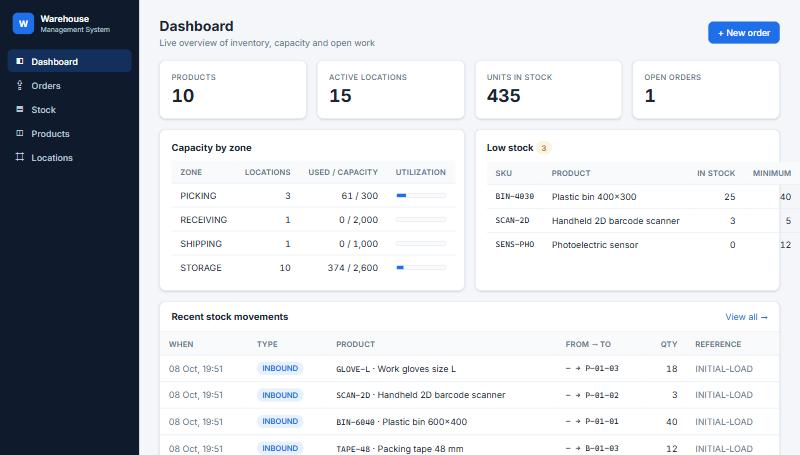
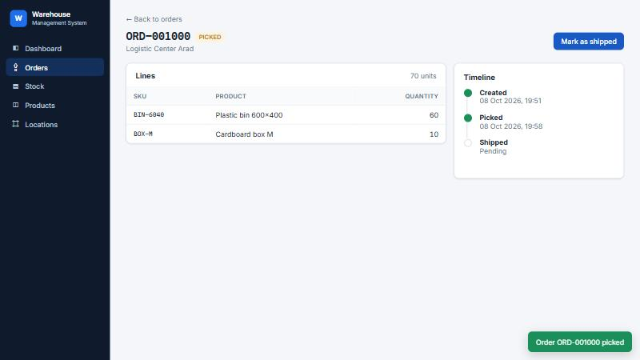
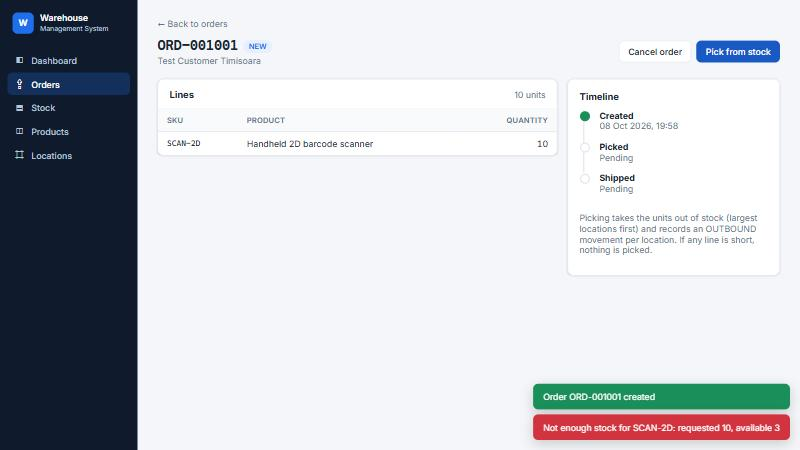
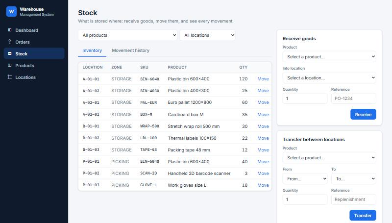
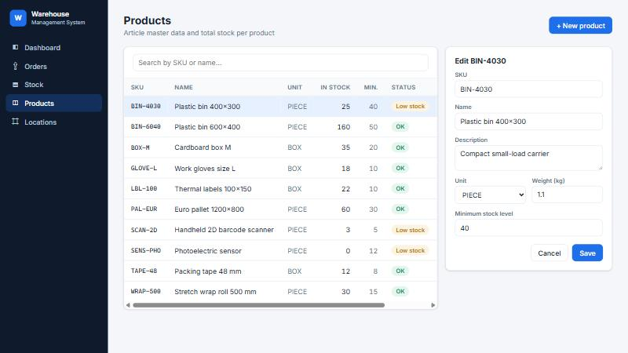
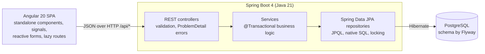
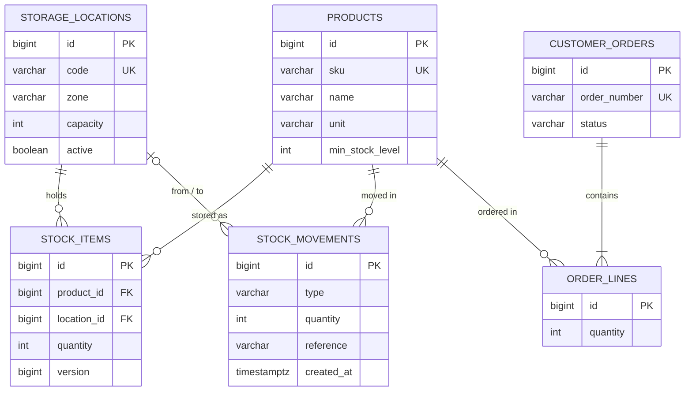

# Warehouse Management System

A full-stack warehouse management application: products, storage locations, stock receiving and transfers, a complete stock-movement audit trail, and outbound orders with **transactional order picking**.

Built with **Java 21 · Spring Boot · Hibernate/JPA · PostgreSQL · Flyway · REST · Angular**.



## Features

- **Dashboard**: KPIs, capacity utilization per warehouse zone (native SQL report), low-stock alerts, latest movements
- **Products**: CRUD with server-side search and pagination; total stock and low-stock status per product
- **Storage locations**: aisle / rack / shelf slots in zones (receiving, storage, picking, shipping) with capacity tracking
- **Stock**: receive goods into a location, transfer between locations, filter inventory by product or location
- **Movement history**: every stock change is recorded as an immutable `INBOUND` / `TRANSFER` / `OUTBOUND` movement
- **Outbound orders**: create orders with multiple lines, then **pick** (stock is taken from as many locations as needed), **ship** or **cancel**
- **Business rules enforced by the backend**: no negative stock, no overfilled or inactive locations, valid order status transitions. Violations come back as clear `409` error messages shown in the UI.

| Picking an order | Not enough stock: nothing is picked |
|---|---|
|  |  |

| Stock | Products |
|---|---|
|  |  |

## Architecture



The backend is organized **by feature** (`product`, `location`, `stock`, `order`, `dashboard`), each with its entity, repository, service, controller and DTOs.

### Data model



## Technical highlights

| Topic | What the project does |
|---|---|
| **Schema management** | Flyway migrations (`V1__initial_schema.sql`, `V2__demo_data.sql`) own the schema, and Hibernate runs with `ddl-auto=validate` to check that entities match it. Constraints (`UNIQUE`, `CHECK`, foreign keys) protect data at the database level too. |
| **Transactions** | Picking an order runs in a single transaction: if any line is short, the whole pick rolls back and the order stays `NEW`. |
| **Concurrency** | Stock rows are locked with `PESSIMISTIC_WRITE` (`SELECT … FOR UPDATE`) while picking, so two orders can never take the same units. `@Version` adds optimistic locking on every stock update. |
| **N+1 avoidance** | `@EntityGraph` fetches related entities in one query, list pages load totals with a single `GROUP BY` query, and `default_batch_fetch_size` batches lazy collections. `open-in-view` is disabled. |
| **SQL** | JPQL with constructor expressions (low-stock report), plus a hand-written native SQL report with a subquery and aggregation (capacity per zone). |
| **Domain logic in entities** | `CustomerOrder` owns its state machine (`NEW → PICKED → SHIPPED`, `NEW → CANCELLED`), and `StockItem` refuses to go negative. |
| **REST design** | Resource-oriented URLs, correct status codes (`201`, `204`, `400`, `404`, `409`), Bean Validation on DTOs, and RFC 9457 *problem details* error bodies with per-field validation errors. |
| **API docs** | OpenAPI / Swagger UI generated from the code. |
| **Frontend** | Angular standalone components, signals, new control flow (`@if`/`@for`), typed reactive forms with a dynamic `FormArray` for order lines, a functional HTTP interceptor for global error toasts, lazy-loaded routes, and a dev proxy to the API. |
| **Tests** | Unit tests for the order state machine, plus integration tests that drive the full stack through HTTP (MockMvc) on an H2 database migrated with the same Flyway scripts. |

## Running locally

**Prerequisites:** JDK 21, Node.js 22, PostgreSQL 15+.

1. Create the database (once):
   ```sql
   CREATE ROLE wms LOGIN PASSWORD 'wms';
   CREATE DATABASE wms OWNER wms;
   ```
2. Start the backend (the first start creates the tables and demo data):
   ```bash
   cd backend
   ./mvnw spring-boot:run        # Windows: mvnw.cmd spring-boot:run
   ```
   - API: http://localhost:8080/api/products
   - Swagger UI: http://localhost:8080/swagger-ui.html
   - Connection settings can be overridden with `DB_URL`, `DB_USERNAME` and `DB_PASSWORD`.
3. Start the frontend:
   ```bash
   cd frontend
   npm install
   npm start
   ```
   Open http://localhost:4200.

### Tests

```bash
cd backend && ./mvnw test
```

## REST API overview

| Method | Endpoint | Description |
|---|---|---|
| GET | `/api/dashboard` | KPIs, zone utilization, low stock, recent movements |
| GET / POST | `/api/products` | List (`?search=&page=&size=&sort=`) / create |
| GET / PUT / DELETE | `/api/products/{id}` | Read / update / delete |
| GET / POST | `/api/locations` | List (`?zone=`) / create |
| GET / PUT / DELETE | `/api/locations/{id}` | Read / update / delete |
| GET | `/api/stock` | Inventory (`?productId=&locationId=`) |
| POST | `/api/stock/receive` | Receive goods into a location |
| POST | `/api/stock/transfer` | Move goods between locations |
| GET | `/api/stock/low-stock` | Products below their minimum level |
| GET | `/api/stock/movements` | Movement history (`?productId=`) |
| GET / POST | `/api/orders` | List (`?status=`) / create |
| GET | `/api/orders/{id}` | Order with lines |
| POST | `/api/orders/{id}/pick` · `/ship` · `/cancel` | Order workflow |

## Project structure

```
backend/   Spring Boot application (Maven)
  src/main/java/com/darius/wms/
    common/      error handling, paging
    product/     location/  stock/  order/  dashboard/
  src/main/resources/db/migration/   Flyway SQL scripts
frontend/  Angular application
  src/app/core/       models, HTTP services, interceptor
  src/app/shared/     pagination, toasts
  src/app/features/   dashboard, products, locations, stock, orders
```
