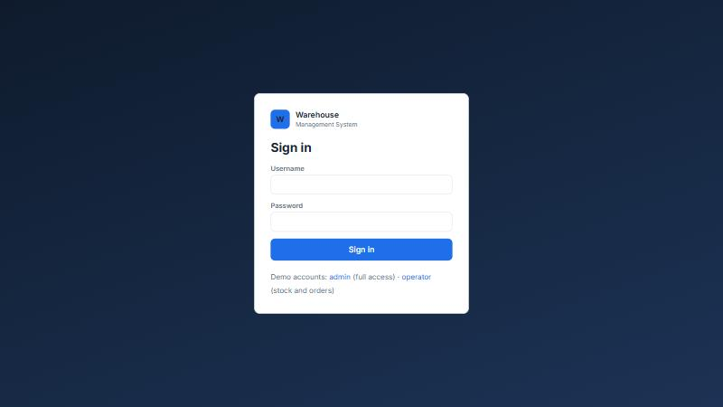
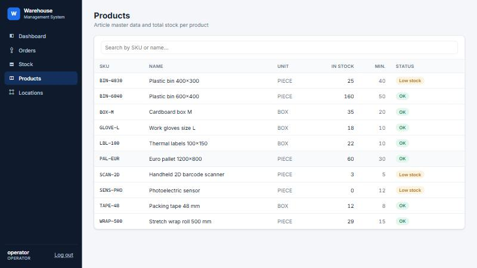
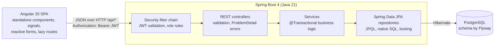
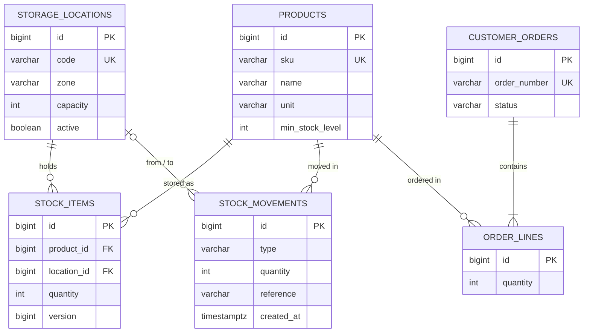

# Warehouse Management System

A full-stack warehouse management application: products, storage locations, stock receiving and transfers, a complete stock-movement audit trail, and outbound orders with **transactional order picking**.

Built with **Java 21 · Spring Boot · Spring Security (JWT) · Hibernate/JPA · PostgreSQL · Flyway · REST · Angular · Docker**.


## Technologies used

### Backend
| Technology | What it is used for in this project |
|---|---|
| **Java 21** | Main backend language; records are used for DTOs (request/response objects) |
| **Spring Boot 4** | Application framework: configuration, dependency injection, embedded web server |
| **Spring Web MVC (REST)** | REST API controllers (`/api/products`, `/api/orders`, ...) returning JSON |
| **Bean Validation** | Checks incoming data (required fields, min/max, formats) before it reaches the business logic |
| **Spring Security** | Login, role-based access rules (ADMIN / OPERATOR), 401/403 handling |
| **JWT (OAuth2 Resource Server, Nimbus)** | Signed access tokens issued at login and validated on every request |
| **BCrypt** | Hashing user passwords; plain passwords are never stored |
| **Hibernate / JPA** | Maps Java entities (Product, StockItem, Order...) to database tables; relationships, transactions, optimistic and pessimistic locking |
| **Spring Data JPA** | Repositories with derived queries, JPQL, native SQL and pagination |
| **SQL** | Database schema, constraints and indexes, demo data, and hand-written reporting queries (low stock, capacity per zone) |
| **PostgreSQL** | The relational database that stores all data |
| **Flyway** | Versioned SQL migrations that create and evolve the schema (`V1`, `V2`, `V3`...) |
| **springdoc OpenAPI / Swagger UI** | Interactive API documentation at `/swagger-ui.html` |
| **Maven (wrapper)** | Builds the project and manages dependencies, with no Maven install needed |
| **JUnit 5, AssertJ, MockMvc** | Unit and integration tests that call the real API over HTTP |
| **Spring Security Test** | Testing endpoints as specific users and roles |
| **H2 (tests only)** | In-memory database in PostgreSQL mode, so tests run without a database server |

### Frontend
| Technology | What it is used for in this project |
|---|---|
| **Angular 20** | Single-page application: dashboard, products, locations, stock and orders screens |
| **TypeScript** | Typed code; interfaces mirror the backend DTOs |
| **Angular Signals** | Reactive state of pages and of the logged-in user |
| **Reactive Forms** | Validated forms, including a dynamic list of order lines (`FormArray`) |
| **Angular Router** | Navigation, lazy-loaded pages, route guard that requires login |
| **HttpClient + interceptors** | API calls; automatically adds the JWT and shows server errors as notifications |
| **RxJS** | Handling asynchronous HTTP responses and debounced search |
| **SCSS** | Styling with shared design tokens (colors, spacing) |
| **Jasmine + Karma** | Unit and component tests, run in a headless browser |

### Infrastructure and tools
| Technology | What it is used for in this project |
|---|---|
| **Docker** | Multi-stage images for the backend (JRE) and frontend (nginx) |
| **Docker Compose** | Starts PostgreSQL, backend and frontend together with one command |
| **nginx** | Serves the built Angular app and forwards `/api` calls to the backend |
| **Git & GitHub** | Version control and hosting of the source code |

## Features

- **Login with roles**: JWT authentication. **ADMIN** manages products and locations; **OPERATOR** receives and moves stock and picks and ships orders. The UI hides actions your role cannot perform, and the API enforces the same rules.
- **Dashboard**: KPIs, capacity utilization per warehouse zone (native SQL report), low-stock alerts, latest movements
- **Products**: CRUD with server-side search and pagination; total stock and low-stock status per product
- **Storage locations**: aisle / rack / shelf slots in zones (receiving, storage, picking, shipping) with capacity tracking
- **Stock**: receive goods into a location, transfer between locations, filter inventory by product or location
- **Movement history**: every stock change is recorded as an immutable `INBOUND` / `TRANSFER` / `OUTBOUND` movement, including **who** performed it
- **Outbound orders**: create orders with multiple lines, then **pick** (stock is taken from as many locations as needed), **ship** or **cancel**
- **Business rules enforced by the backend**: no negative stock, no overfilled or inactive locations, valid order status transitions. Violations come back as clear `409` error messages shown in the UI.

| Picking an order | Not enough stock: nothing is picked |
|---|---|
|  |  |

| Stock | Products |
|---|---|
|  |  |

| Login | Operator view: no master-data actions |
|---|---|
|  |  |

## Architecture



The backend is organized **by feature** (`product`, `location`, `stock`, `order`, `dashboard`, `security`), each with its entity, repository, service, controller and DTOs.

### Data model



## Technical highlights

| Topic | What the project does |
|---|---|
| **Authentication** | `POST /api/auth/login` checks the BCrypt password hash and returns an HS256-signed JWT (subject, roles, expiry). Every other request is **stateless**: Spring Security's OAuth2 resource server validates the signature, issuer and expiry, and maps the `roles` claim to `ROLE_*` authorities. There is no session and no cookie, so CSRF protection is not needed. Trade-off: the SPA keeps the token in `localStorage`. That's simple, but script injection (XSS) could read it; an `httpOnly` cookie would be the stricter alternative. |
| **Authorization** | URL rules in one place (`SecurityConfig`): reads for any logged-in user, products/locations for `ADMIN`, stock and orders for `ADMIN`/`OPERATOR`, and everything else denied by default. 401/403 errors use the same problem-detail JSON as the rest of the API. |
| **Schema management** | Flyway migrations (`V1__initial_schema.sql`, `V2__demo_data.sql`) own the schema, and Hibernate runs with `ddl-auto=validate` to check that entities match it. Constraints (`UNIQUE`, `CHECK`, foreign keys) protect data at the database level too. |
| **Transactions** | Picking an order runs in a single transaction: if any line is short, the whole pick rolls back and the order stays `NEW`. |
| **Concurrency** | Stock rows are locked with `PESSIMISTIC_WRITE` (`SELECT … FOR UPDATE`) while picking, so two orders can never take the same units. `@Version` adds optimistic locking on every stock update. |
| **N+1 avoidance** | `@EntityGraph` fetches related entities in one query, list pages load totals with a single `GROUP BY` query, and `default_batch_fetch_size` batches lazy collections. `open-in-view` is disabled. |
| **SQL** | JPQL with constructor expressions (low-stock report), plus a hand-written native SQL report with a subquery and aggregation (capacity per zone). |
| **Domain logic in entities** | `CustomerOrder` owns its state machine (`NEW → PICKED → SHIPPED`, `NEW → CANCELLED`), and `StockItem` refuses to go negative. |
| **REST design** | Resource-oriented URLs, correct status codes (`201`, `204`, `400`, `404`, `409`), Bean Validation on DTOs, and RFC 9457 *problem details* error bodies with per-field validation errors. |
| **API docs** | OpenAPI / Swagger UI generated from the code. |
| **Frontend** | Angular standalone components, signals, new control flow (`@if`/`@for`), typed reactive forms with a dynamic `FormArray` for order lines, lazy-loaded routes, and functional interceptors: one adds the bearer token and logs out on 401, one shows errors as toasts. A route guard protects all pages and remembers the requested URL, and the login page only redirects to in-app paths (no open redirect). |
| **Backend tests** | 16 tests: unit tests for the order state machine, integration tests that drive the full stack through HTTP (MockMvc) on an H2 database migrated with the same Flyway scripts, and security tests with real logins and JWTs (wrong password, missing or tampered token, operator vs. admin permissions, audit of who moved stock). |
| **Frontend tests** | 33 Jasmine/Karma tests: services with `HttpTestingController`, both interceptors, the route guard, the login page (including the open-redirect check), role-based buttons, the dynamic order form and pagination. |
| **Docker** | Multi-stage images (JDK to build, JRE to run, as a non-root user; Node to build, nginx to serve). nginx proxies `/api` to the backend, and Compose waits for PostgreSQL's health check before starting the backend. |

## Running with Docker (easiest)

With [Docker Desktop](https://www.docker.com/products/docker-desktop/) installed:

```bash
docker compose up --build
```

Open http://localhost:8081 and log in with **admin / admin123** or **operator / operator123**. Swagger UI is at http://localhost:8081/swagger-ui.html.

## Running locally (for development)

**Prerequisites:** JDK 21, Node.js 22, PostgreSQL 15+.

1. Create the database (once):
   ```sql
   CREATE ROLE wms LOGIN PASSWORD 'wms';
   CREATE DATABASE wms OWNER wms;
   ```
2. Start the backend (the first start creates the tables and demo data):
   ```bash
   cd backend
   ./mvnw spring-boot:run        # Windows: mvnw.cmd spring-boot:run
   ```
   - API: http://localhost:8080/api/products
   - Swagger UI: http://localhost:8080/swagger-ui.html
   - Connection settings can be overridden with `DB_URL`, `DB_USERNAME` and `DB_PASSWORD`, and the token signing key with `JWT_SECRET` (at least 32 characters; the built-in default is for development only).
3. Start the frontend:
   ```bash
   cd frontend
   npm install
   npm start
   ```
   Open http://localhost:4200 and log in with **admin / admin123** or **operator / operator123**.

### Tests

```bash
cd backend && ./mvnw test
```

```bash
cd frontend && npm run test:ci
```

The frontend tests run in headless Chrome, or in Microsoft Edge when Chrome is not installed.

## REST API overview

| Method | Endpoint | Description |
|---|---|---|
| POST | `/api/auth/login` | Returns a JWT (public) |
| GET | `/api/auth/me` | Current user and roles |
| GET | `/api/dashboard` | KPIs, zone utilization, low stock, recent movements |
| GET / POST | `/api/products` | List (`?search=&page=&size=&sort=`) / create |
| GET / PUT / DELETE | `/api/products/{id}` | Read / update / delete |
| GET / POST | `/api/locations` | List (`?zone=`) / create |
| GET / PUT / DELETE | `/api/locations/{id}` | Read / update / delete |
| GET | `/api/stock` | Inventory (`?productId=&locationId=`) |
| POST | `/api/stock/receive` | Receive goods into a location |
| POST | `/api/stock/transfer` | Move goods between locations |
| GET | `/api/stock/low-stock` | Products below their minimum level |
| GET | `/api/stock/movements` | Movement history (`?productId=`) |
| GET / POST | `/api/orders` | List (`?status=`) / create |
| GET | `/api/orders/{id}` | Order with lines |
| POST | `/api/orders/{id}/pick` · `/ship` · `/cancel` | Order workflow |

## Project structure

```
backend/   Spring Boot application (Maven)
  src/main/java/com/darius/wms/
    common/      error handling, paging
    security/    users, JWT login, SecurityConfig
    product/     location/  stock/  order/  dashboard/
  src/main/resources/db/migration/   Flyway SQL scripts
frontend/  Angular application
  src/app/core/       models, HTTP services, auth service, guard, interceptors
  src/app/shared/     pagination, toasts
  src/app/features/   login, dashboard, products, locations, stock, orders
docker-compose.yml   PostgreSQL + backend + frontend (nginx)
```
